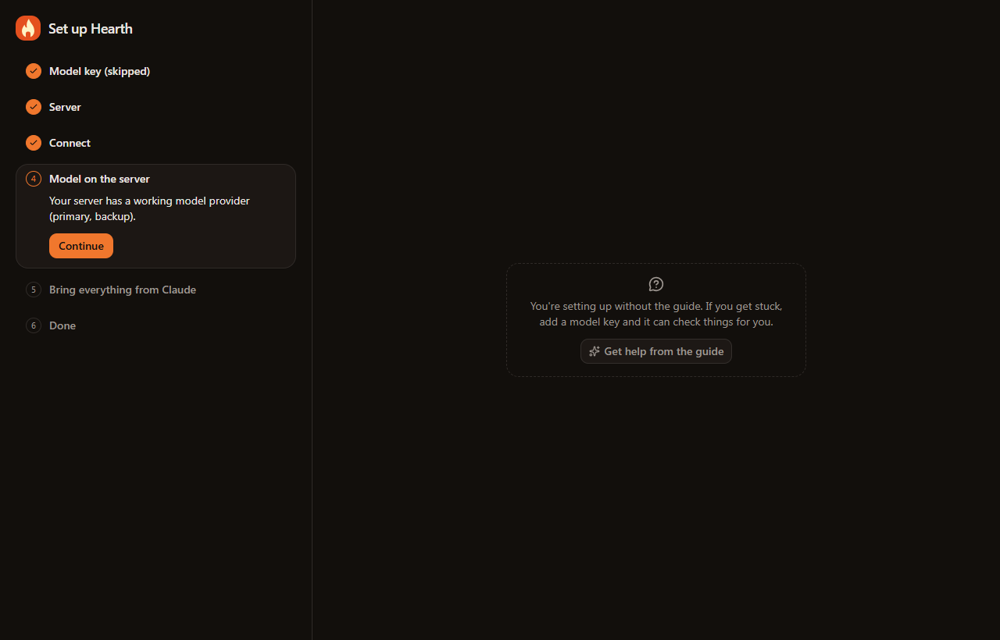
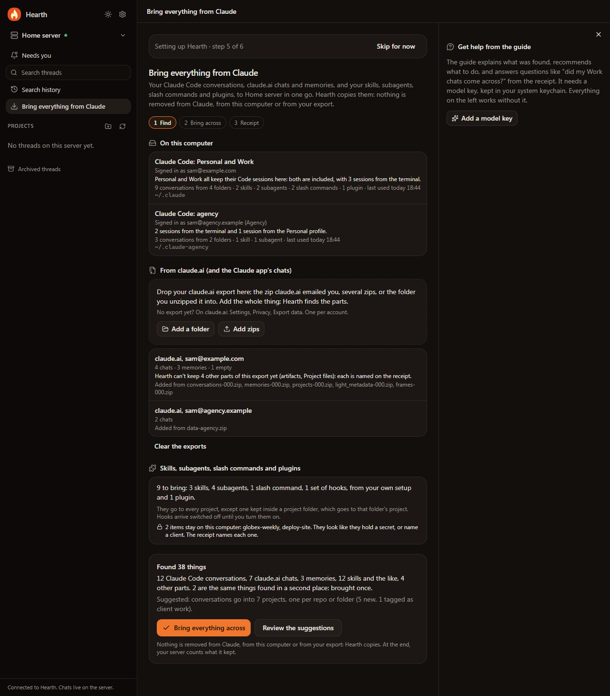
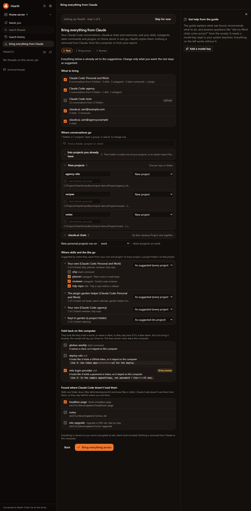
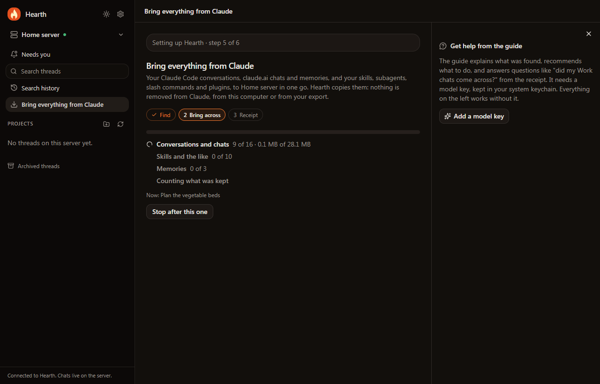
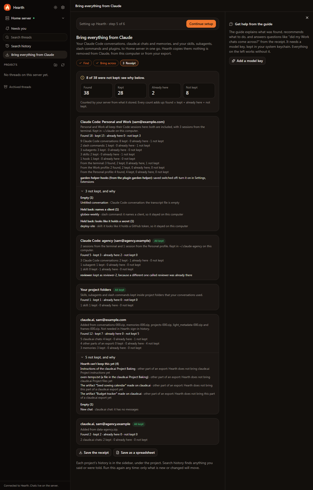
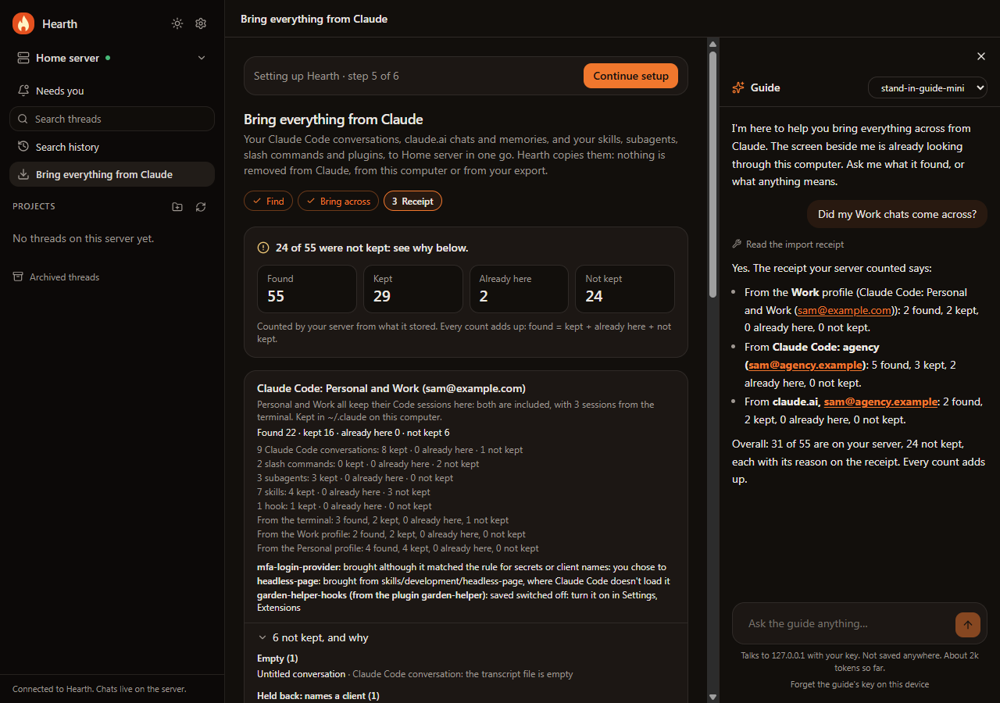
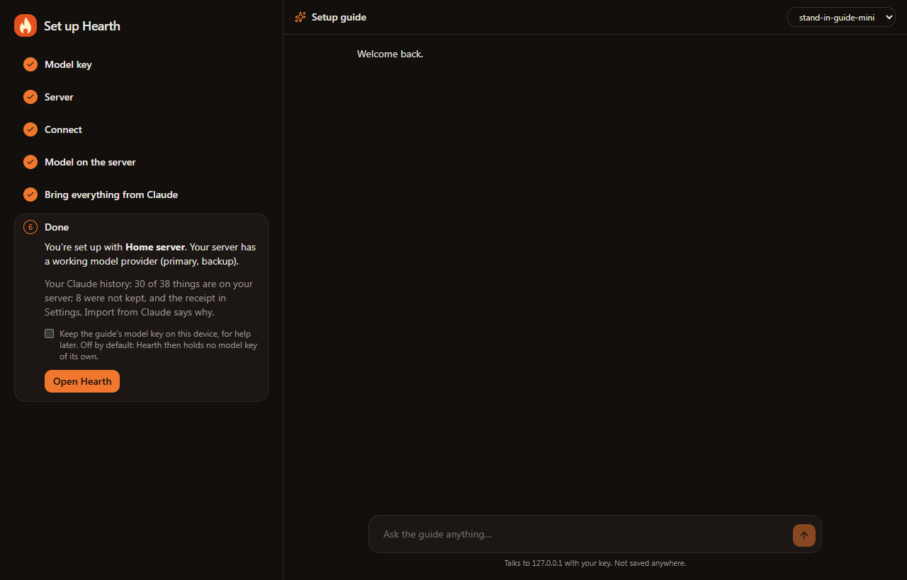
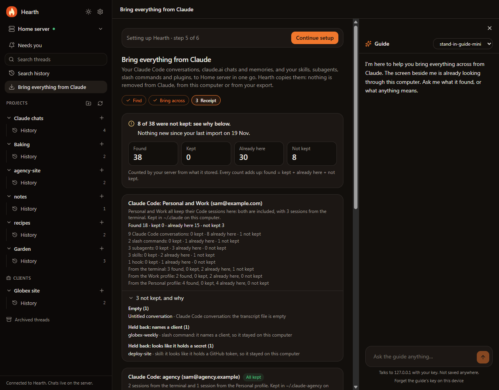
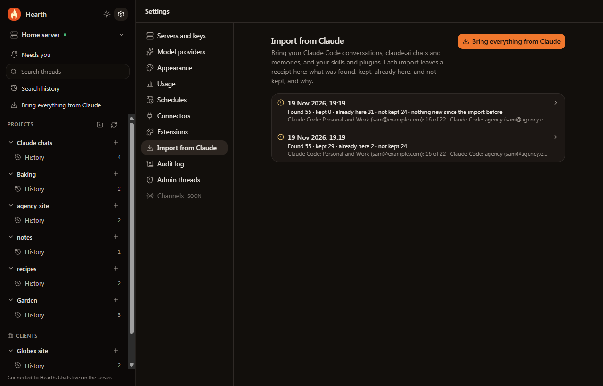
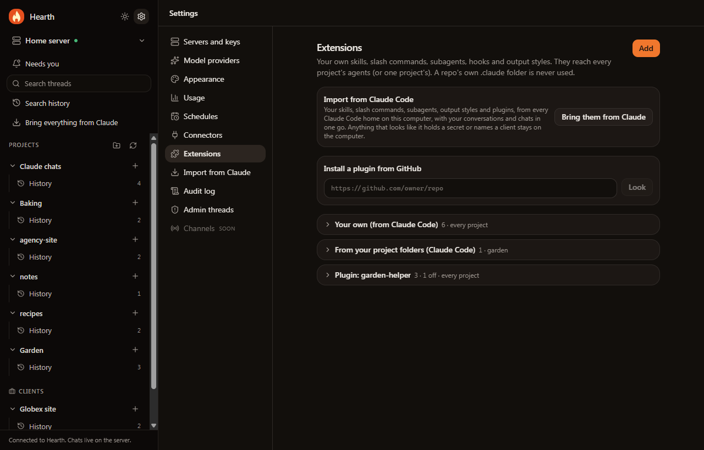

# Bring everything from Claude

One guided flow that brings across everything a person has in Claude, and shows, counted by their own server, that it was kept. Built 19 Nov 2026 after the first real import, which "was complex and felt like I was losing data".

## What it brings

| From | What | Where it goes |
|---|---|---|
| Every Claude Code home on this computer (`~/.claude`, every `~/.claude-*`, `$CLAUDE_CONFIG_DIR`) | Conversations, with their subagent threads and tool output | One project per repo or working folder, client work tagged; sealed at rest on the server |
| The same homes | Skills, subagents, slash commands, output styles; plugins' skills and hooks | Owner extensions: every project. Hooks arrive switched off |
| Project folders the conversations used (`<repo>/.claude/...`) | Skills, subagents, slash commands, output styles | That folder's project |
| A claude.ai export, as the person has it | Chats (also the Claude app's Chat tab), memories | Chats by their claude.ai Project; memories to the knowledge hub |

Nothing is ever removed from Claude, from the computer or from the export. Hearth copies.

## The flow

1. **Find** (automatic, read-only). The desktop app lists every Claude Code home and describes it in the person's terms, from the desktop Claude app's own data: which profile keeps its Code sessions there ("Personal and Work all keep their Code sessions here: both are included, with 199 sessions from the terminal"), which account is signed in (its `.claude.json`: email and organisation only, never a token), when it was last used and what it holds. Then it reads every conversation (progress on screen; nothing is sent yet) and every skill and the like. The claude.ai export is dropped or picked whole: the zip claude.ai emailed, several zips, or the folder it was unzipped into (which today holds more zips: `conversations-000.zip`, `memories-000.zip`, `projects-000.zip`, ...). Zips inside folders and zips inside zips are opened; the parts are found by name. Nobody picks files out of an export.
2. **One button.** The server proposes the plan (`_hearth/import/preview`): a project per repo or folder, merges for copies and branches, client tags as before. "Bring everything across" applies it. "Review the suggestions" is optional: what to bring (each home and account can be left out), where conversations go (grouped: into projects you have, new projects, client projects, joined, claude.ai chats, home and one-off folders, left out; collapsed, with a search box), and where each group of skills goes.
3. **The receipt.** The server counts what it stored and the app shows it (below). It is kept on the server and reopened from Settings, Import from Claude.

The same flow opens from the sidebar ("Bring everything from Claude"), from Settings, Import from Claude, from Settings, Extensions (at its skills part), after adding a server that has no history yet, and as step 5 of first-run setup.

### What it looks like

Made-up data on the desktop dev build, against a throwaway server (19 Nov):

| Step | |
|---|---|
| Setup's checklist, with the new Import step |  |
| Find: two homes in the person's terms, a claude.ai export added as loose zips, skills, the one button |  |
| Review (optional): what to bring, where conversations go (grouped, searchable), where skills go |  |
| Bringing it across |  |
| The receipt |  |
| The guide answering from the receipt (a scripted stand-in model; no real key) |  |
| Setup's Done step |  |
| A second run: everything already here |  |
| Settings, Import from Claude: every receipt, reopened and saved |  |
| Settings, Extensions opens the same flow at its skills part |  |

## What stays on the computer

- A skill, subagent, slash command or output style that looks like it holds a secret (the same patterns as the server's scrubber and runner), or that names a client (the server's client names), is never sent. It is on the receipt as held back, with the reason. The server checks everything again before it saves.
- `settings.json`, credentials and a project folder's hooks are never read.
- Claude Code conversations are sent as they are (the old rule): sealed at rest, keys scrubbed on display and in the knowledge hub.

## Choices that stick, and what is never passed over

- **Each home at a glance:** besides who and what, its date range, the folder most of it is in, and the commonest projects, so a home of old test runs is obvious ("13 conversations, 7 to 10 Oct 2026 · 12 in pm-hq · most in acme-api (5)").
- **Remembered:** what is left out (a home, a folder, a group of skills, a single one) and what is brought anyway is kept on the server (`core.cc_decisions`, `import:*`). The next run starts from the same choices and the receipt says since when ("you left this out on 18 Nov").
- **Skills one folder down** (`skills/development/<name>`) and loose files in `skills/` are found and listed as not loadable where they are (Claude Code doesn't load them there either), with a tick box to bring them.
- **Held back, with the reason in full:** a skill held for a secret shows the matching line here, mostly hidden, so a false alarm can be brought anyway. The line never leaves the computer; the receipt names only the line number, and that the owner chose to bring it.
- **Changed or not, by content:** the fingerprint is names, sizes and the main transcript's content hash (read in the same pass as its facts), never file dates. On the server, a stored conversation whose files, sizes and content hash match is already here even under an older fingerprint, and is not sent again. (212 of the first real import's transcripts had only their dates changed by a copy on 12 Nov.)

## The receipt

For every source (each Claude Code home, project folders, each claude.ai account): **found, kept, already here, not kept**, per kind (conversations, chats, memories, skills, ...) and, for a home shared by desktop profiles, per profile. Every thing not kept is named with its reason:

| Reason | Means |
|---|---|
| Empty | A chat with no messages, an empty transcript file |
| Held back: looks like it holds a secret / names a client | Stayed on the computer on purpose |
| Couldn't be read | The file could not be read (locked, gone, not text) |
| Hearth can't keep this yet | claude.ai artifacts and Project files and instructions, feedback, Claude Code on the web routines; a file name Hearth can't use as an id |
| You chose to leave it out | Left out on the review page |
| Didn't arrive | Sent but not stored; tried again next time |
| Not sent: the import was stopped | Stop was pressed |
| This server has nowhere to keep it | Memories on a server without a knowledge hub |

"Already here" covers what an earlier import kept and the same thing found twice (a conversation copied between two homes, the same skill in two homes): the receipt says which copy.

Found always equals kept + already here + not kept, per source, per kind and in total. The top line says so: "Everything found was kept (1,034 things)" or "3 of 1,034 were not kept: see why below". A re-run says how many are new since the last import.

**Counted from stored data, never written by a model.** The app sends what it found (`inventory` on `_hearth/import/preview`). At `_hearth/import/finish` the server works out each thing's outcome from its own store: a conversation is kept when its row is sealed, its stored fingerprint is the one found and every sealed file is on disk; a skill when `core.extensions` holds that content (by hash); a memory by the knowledge hub's answer for it. The receipt is saved sealed in `core.cc_runs` (a summary without titles beside it), listed by `_hearth/import/receipts` and reopened by `_hearth/import/receipt`. It can be saved as text or as a spreadsheet.

## The guide

The setup guide walks the import (its checklist's step 5) and sits beside the import view whenever this desktop keeps a guide key. Without one the flow works the same, and the panel offers to add a key. Two read-only tools:

- `import_sources`: what the screen found, in words and numbers (src/lib/importState.ts). No content.
- `import_receipt`: the latest receipt (src/lib/receipt.ts `forGuide`). Client names and Claude Code conversation titles are left out, because the guide's model may be a third-party service.

Its prompt says: recommend the one button; never say something was kept unless `import_receipt` says so; answer "did my Work chats come across?" with that source's or profile's numbers.

## Where the code is

| Part | Where |
|---|---|
| Homes, profiles, accounts, conversations, skills and the like on this computer | `src-tauri/src/import.rs` (`import_sources`, `import_scan`, `import_read`, `import_config`; tests with a fixture of two homes and two profiles) |
| claude.ai export reader (zips, folders, nested zips) | `src/lib/claudeai.ts`, `src/lib/dropfiles.ts` |
| Inventory, what is held back, the run | `src/lib/importer.ts` (`gather`, `bringAcross`), `src/lib/secrets.ts` |
| Receipt in words, saved files, the guide's copy | `src/lib/receipt.ts` |
| Screens | `src/components/hearth/ImportWizard.tsx`, `ImportView.tsx` (with the guide), `ImportReceipt.tsx`, `ImportHistory.tsx` |
| Server | hearth-server `core/src/ccimport.ts` (`extensions`, `memories` with `runId`, `finish`, `receipts`, `receipt`), `core/src/importreceipt.ts` (the maths) |
| Tests | `src/lib/{claudeai,importer,receipt,guide}.test.ts`; `cargo test import::`; hearth-server `core/test/unit/importreceipt.test.ts` and `core/test/import-everything-local.ts` (the real engine against a throwaway server: two homes, two profiles sharing one, a zipped and an unzipped export with memories, a duplicate, an empty one, a secret, a client name; the receipt adds up per source, is kept, and says what is new on a re-run) |
